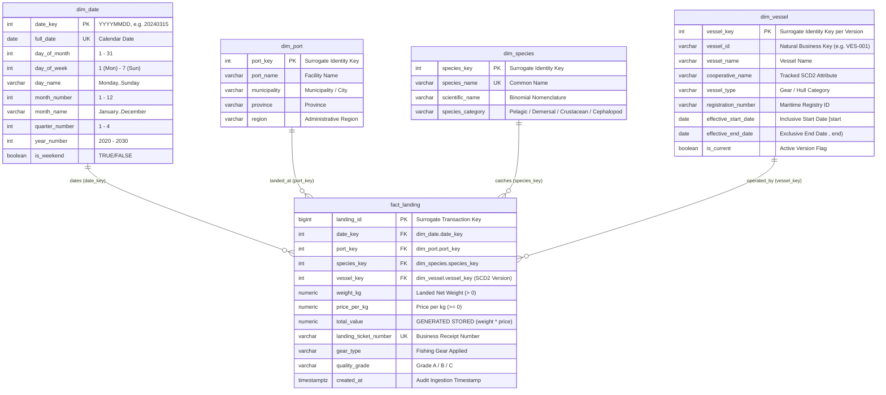

# Fisheries Star Schema Design Document

## 1. Executive Summary

The **Fisheries Star Schema Data Warehouse** is an analytical data warehouse built on PostgreSQL 16+ to model, monitor, and analyze marine fisheries catch landings. It transforms operational transactional landing data into a conformed dimensional model following Ralph Kimball's dimensional modeling methodology.

At its core, the schema centralizes commercial landing transactions in a single fact table (`dw.fact_landing`) surrounded by conformed dimensions representing time (`dw.dim_date`), landing geography (`dw.dim_port`), marine taxonomy (`dw.dim_species`), and fishing vessels (`dw.dim_vessel`). A standout architectural feature is the implementation of **Slowly Changing Dimension Type 2 (SCD Type 2)** on `dw.dim_vessel`, ensuring point-in-time historical reporting accuracy when vessels change cooperative affiliations or descriptive attributes.

---

## 2. Dimensional Architecture & Entity-Relationship Diagram

The warehouse employs a classic **Star Schema** architecture. The central fact table references four conformed dimension tables through surrogate foreign keys.



---

## 3. Fact Table Specification: `dw.fact_landing`

### 3.1 Grain Definition
The grain of `dw.fact_landing` represents **one row per individual catch landing transaction or landing event** at a designated port facility. Every row corresponds to a single commercial weigh-in ticket recording a specific species unloaded from a specific vessel on a specific calendar date.

### 3.2 Measures Classification
| Measure Column | SQL Type | Measure Classification | Additivity | Description |
| :--- | :--- | :--- | :--- | :--- |
| `weight_kg` | `NUMERIC(10,2)` | Base Measure | **Fully Additive** | Net landed fish weight in kilograms. Can be summed across all dimensions (time, port, species, vessel). |
| `price_per_kg` | `NUMERIC(10,2)` | Base Measure | **Non-Additive** | Agreed price in PHP/kg. Cannot be summed across transactions; meaningful only via weighted averages or slice inspection. |
| `total_value` | `NUMERIC(12,2)` | Derived Stored Measure | **Fully Additive** | Commercial transaction gross value in PHP (`weight_kg * price_per_kg`). Fully additive across all dimensional hierarchies. |
| `landing_id` | `BIGINT` | Fact Surrogate Key | **Non-Additive** | Primary surrogate key for the event; useful for `COUNT(landing_id)` to tally transaction counts. |

### 3.3 Generated Stored Column Implementation
PostgreSQL 12+ supports generated columns. `total_value` is defined as:
```sql
total_value NUMERIC(12,2) GENERATED ALWAYS AS (ROUND(weight_kg * price_per_kg, 2)) STORED
```
**Benefits:**
- **Zero Calculation Discrepancies:** Eliminates client-side or ETL rounding inconsistencies.
- **Precomputed Storage:** Because it is `STORED`, query aggregations (`SUM(total_value)`) read precomputed bytes directly off disk without on-the-fly multiplication overhead.
- **Enforced Parity:** Cannot be directly overridden by `UPDATE` or `INSERT`, guaranteeing mathematical integrity.

---

## 4. Conformed Dimensions Specification

### 4.1 Date Dimension: `dw.dim_date`
- **Role:** Conformed time-intelligence dimension covering 11 full calendar years (2020-01-01 through 2030-12-31), totaling **4,018 distinct dates**.
- **Key Strategy:** Smart integer key formatted as `YYYYMMDD` (e.g. `20240315`).
  * *Advantage:* Allows partition pruning, human readability without joins during initial inspection, and compact 4-byte integer indexing.
- **Calendar Attributes:**
  * `full_date` (`DATE UNIQUE`): ISO calendar date.
  * `day_of_week` (`INTEGER`): ISO 8601 convention (1 = Monday, ..., 7 = Sunday).
  * `day_name` (`VARCHAR(15)`): Full English weekday name ('Monday', 'Tuesday', etc.).
  * `is_weekend` (`BOOLEAN`): `TRUE` for Saturday and Sunday, allowing fast weekend vs weekday filtering without date functions in `WHERE` clauses.
  * `month_number` (`1-12`), `month_name` ('January'..'December'), `quarter_number` (`1-4`), `year_number` (2020..2030).

### 4.2 Port Dimension: `dw.dim_port`
- **Role:** Conformed geographic dimension defining the physical landing infrastructure.
- **Attributes:**
  * `port_key` (`INT GENERATED ALWAYS AS IDENTITY PK`): Surrogate primary key.
  * `port_name` (`VARCHAR(100)`): Recognized facility name (e.g., 'Navotas Fish Port Complex').
  * `municipality` / `province` / `region`: Geographic hierarchy enabling roll-ups by town, province, or macro-region.
  * Natural key uniqueness: `UNIQUE (port_name, municipality, province)`.

### 4.3 Species Dimension: `dw.dim_species`
- **Role:** Conformed biological and economic classification of marine catch.
- **Attributes:**
  * `species_key` (`INT GENERATED ALWAYS AS IDENTITY PK`): Surrogate primary key.
  * `species_name` (`VARCHAR(100) UNIQUE`): Common local/trade name (e.g., 'Yellowfin Tuna', 'Round Scad (Galunggong)').
  * `scientific_name` (`VARCHAR(150)`): Linnaean binomial nomenclature (e.g., *Thunnus albacares*).
  * `species_category` (`VARCHAR(50)`): Ecological category (`Pelagic`, `Demersal`, `Crustacean`, `Cephalopod`, `Mollusk`).

---

## 5. Slowly Changing Dimension Type 2 (SCD Type 2) Architecture

### 5.1 Business Requirement & Problem Statement
In commercial fisheries management, vessels frequently alter operational characteristics over their lifespans:
1. Transferring between fisherfolk cooperatives or commercial fishing fleets.
2. Undergoing vessel retrofitting or gear reclassification (e.g., Handline to Longline).
3. Transferring maritime registry jurisdictions.

If a vessel changes its cooperative affiliation (e.g., transferring from *Navotas Deep Sea Fisherfolk Union* to *Visayas Artisanal Fisherfolk Alliance*), using an **SCD Type 1 (in-place overwrite)** model would retroactively overwrite the vessel's past cooperative across all historical landing records. This would distort historical cooperative revenue audits, misattribute catch volumes, and violate compliance standards.

### 5.2 SCD Type 2 Solution
Under SCD Type 2:
- The natural business key `vessel_id` (e.g., `'VES-001'`) remains stable across time.
- A new surrogate key `vessel_key` is assigned to each temporal version of the vessel.
- Previous versions are closed by setting an exclusive expiration date and flipping `is_current = FALSE`.
- New versions are inserted with `is_current = TRUE` and an open-ended validity range.

```text
Version 1 (Historical):
  vessel_key: 4
  vessel_id: VES-001
  cooperative_name: Navotas Deep Sea Fisherfolk Union
  effective_start_date: 2020-01-01
  effective_end_date:   2024-07-01  <-- Closed on date of transfer
  is_current:           FALSE

Version 2 (Current):
  vessel_key: 9
  vessel_id: VES-001
  cooperative_name: Visayas Artisanal Fisherfolk Alliance  <-- New cooperative
  effective_start_date: 2024-07-01  <-- Starts on date of transfer
  effective_end_date:   9999-12-31  <-- Open-ended high date
  is_current:           TRUE
```

### 5.3 Date Boundary Convention: Half-Open Intervals `[start, end)`
We adopt the mathematically rigorous **inclusive start date, exclusive end date** convention:
$$\text{Version is valid if: } \text{effective\_start\_date} \le \text{landing\_date} < \text{effective\_end\_date}$$

**Advantages of Half-Open Intervals `[start, end)`:**
1. **Zero Gaps, Zero Overlaps:** When Version 1 ends on `2024-07-01` and Version 2 begins on `2024-07-01`, a landing occurring on `2024-06-30` belongs unambiguously to Version 1, while a landing occurring on `2024-07-01` belongs unambiguously to Version 2.
2. **Simplified Temporal Range Queries:**
   ```sql
   JOIN dw.dim_vessel v 
     ON v.vessel_id = src.vessel_id
    AND v.effective_start_date <= src.landing_date 
    AND src.landing_date < v.effective_end_date
   ```
3. **Open-Ended Boundary:** Current records have `effective_end_date = '9999-12-31'`, avoiding `NULL` handling anomalies in standard SQL comparison operators (`<` and `BETWEEN`).

### 5.4 Database-Level SCD2 Integrity Constraints
To enforce dimensional integrity directly in the PostgreSQL engine, two critical constraints are configured:

1. **Single Current Record Index (Partial Unique Index):**
   ```sql
   CREATE UNIQUE INDEX uq_dim_vessel_one_current 
       ON dw.dim_vessel (vessel_id) 
       WHERE is_current = TRUE;
   ```
   *Guarantees that no vessel can ever possess more than one record marked `is_current = TRUE` simultaneously.*

2. **Temporal Non-Overlap Exclusion Constraint (`btree_gist`):**
   ```sql
   ALTER TABLE dw.dim_vessel
       ADD CONSTRAINT uq_dim_vessel_no_overlap
       EXCLUDE USING gist (
           vessel_id WITH =,
           daterange(effective_start_date, effective_end_date, '[)') WITH &&
       );
   ```
   *Prevents concurrent or corrupt ETL pipelines from inserting overlapping temporal validity ranges for the same `vessel_id`. Any overlapping range triggers an immediate database exception.*

---

## 6. Why the Fact Table References Surrogate Keys (`vessel_key`)

A fundamental rule of dimensional modeling is that **fact tables must reference the surrogate key (`vessel_key`) rather than the business identifier (`vessel_id`)**.

| Criterion | Referencing `vessel_id` (Business Key) | Referencing `vessel_key` (Surrogate Key) |
| :--- | :--- | :--- |
| **Historical Accuracy** | ❌ **Broken.** Querying by vessel or joining to current cooperative attributes misreports historical catch under the vessel's current cooperative. | ✅ **Preserved.** Fact rows permanently store the specific version key active on the landing date. |
| **Query Performance** | ❌ **Slow & Complex.** Every star join requires complex temporal range evaluations: `ON f.vessel_id = v.vessel_id AND f.landing_date >= v.start AND f.landing_date < v.end`. | ✅ **Fast & Simple.** Joins are simple single-column integer equality lookups: `ON f.vessel_key = v.vessel_key`. |
| **Audit Compliance** | ❌ **Non-compliant.** Past audited financial periods change whenever a dimension attribute updates. | ✅ **Strictly Audited.** Past financial periods remain 100% immutable and invariant. |

---

## 7. Indexing & Physical Storage Strategy

The star schema is optimized for dimensional slicing, dicing, and aggregations:

1. **Foreign Key Indexes:**
   - `idx_fact_landing_date ON dw.fact_landing (date_key)`: Optimizes chronological range queries and monthly aggregations.
   - `idx_fact_landing_port ON dw.fact_landing (port_key)`: Optimizes port-level filtering.
   - `idx_fact_landing_species ON dw.fact_landing (species_key)`: Optimizes species-level aggregations.
   - `idx_fact_landing_vessel ON dw.fact_landing (vessel_key)`: Optimizes joins to vessel dimensions and cooperative roll-ups.
   - `idx_fact_landing_port_species ON dw.fact_landing (port_key, species_key)`: Composite index optimizing port-species co-occurrence and ranking queries.

2. **SCD Type 2 Lookup Index:**
   - `idx_dim_vessel_lookup ON dw.dim_vessel (vessel_id, effective_start_date, effective_end_date)`: Facilitates point-in-time ETL lookups when staging transactions.
